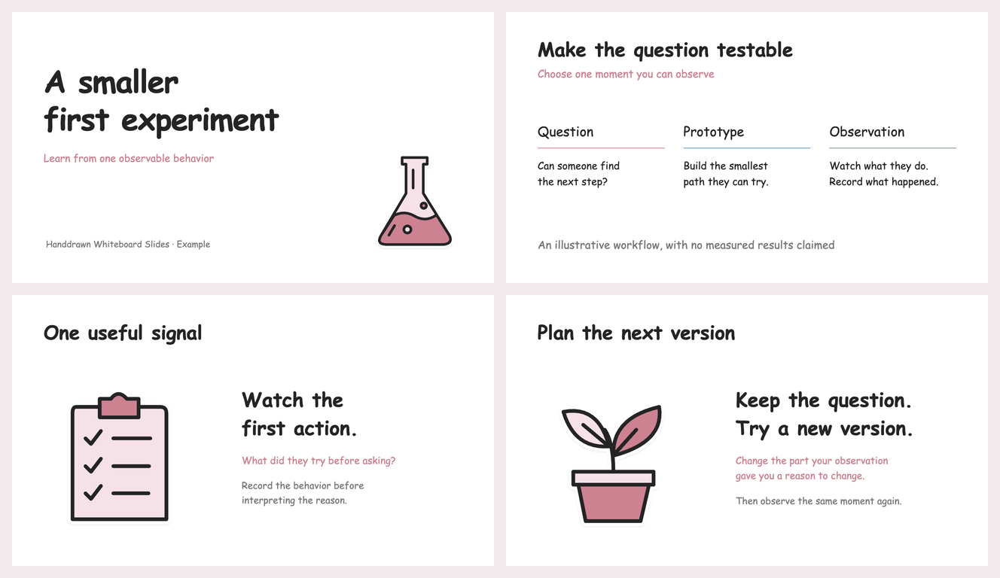
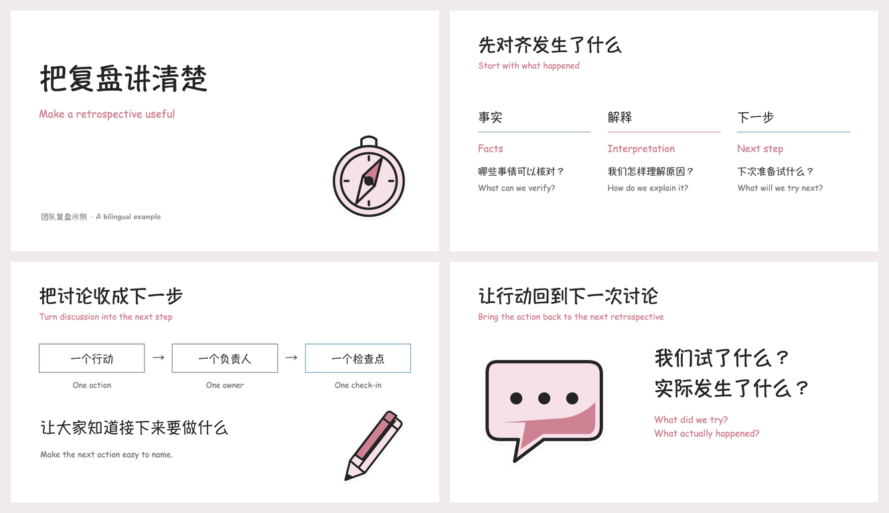
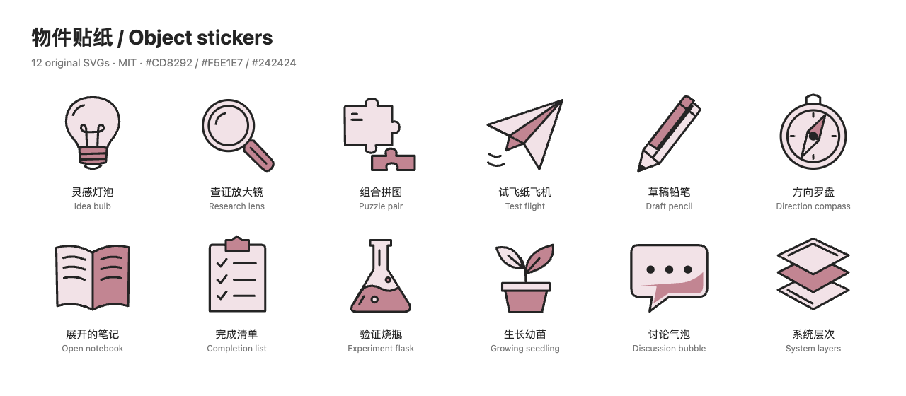

# Handdrawn Whiteboard Slides

[中文](README.md) · [English](README.en.md)

**Turn a set of notes into a few clear, approachable slides.**

A Codex skill for presentations with white backgrounds, handwritten type, pink accents, editable diagrams and ready-to-use object stickers. Use it for technical talks, tutorials, proposals, product experiments and team retrospectives.


[](LICENSE) [](https://github.com/Yaosc972/handdrawn-whiteboard-slides/actions/workflows/check.yml)

## What is included

- **A reusable presentation workflow.** Select the important content, choose a layout that explains its relationships, and give each slide one purpose.
- **12 original SVG stickers.** Transparent artwork with white cut edges and a consistent pink palette, included under the MIT license. Use them directly or recolor the whole set.
- **Three runnable examples.** Thirteen slides across Chinese, English and bilingual decks. Each includes a PDF and an offline HTML version with navigation, full-screen mode and print support.
- **A focused editing workflow.** Replace illustrations while preserving existing text, diagrams, backgrounds and slide count.

This repository contains a skill, an asset pack and example decks. It does not bundle a general slide-generation engine. The skill works with the presentation tools available in your environment, including PowerPoint, HTML and online slide tools. The included examples are HTML; prebuilt PPTX files are not included.

## Install

```bash
git clone https://github.com/Yaosc972/handdrawn-whiteboard-slides.git \
  ~/.codex/skills/handdrawn-whiteboard-slides
```

If you use a custom `CODEX_HOME`, place the repository in its `skills/handdrawn-whiteboard-slides` directory. Start a new Codex session after installation. To update:

```bash
git -C ~/.codex/skills/handdrawn-whiteboard-slides pull --ff-only
```

The skill itself does not require Node.js. The sticker exporter and repository checks require **Node.js 22+**. There is no `npm install` step and no API key requirement.

## Try a prompt

Create a presentation from source material:

```text
Use $handdrawn-whiteboard-slides to turn these notes into five slides
for colleagues who are new to the topic. Use a white background,
handwritten type, pink accents and object stickers instead of people.
Keep text and explanatory diagrams editable.
```

Restyle an existing deck:

```text
Use $handdrawn-whiteboard-slides to replace the characters in this deck
with object stickers. Preserve the text, diagrams, backgrounds and slide
count. Adjust only the illustrations and their placement.
```

Create Chinese content:

```text
使用 $handdrawn-whiteboard-slides，把这份材料做成 4 页中文演示。
每页只讲一个重点，保留白底、手写字与粉色强调，用物件贴纸。
```

Specify your audience, language, slide count, accent color, fonts and output format. Explicit user requirements take precedence over the defaults. The skill instructions are written in Chinese; presentations can use either language.

## Examples

Open the [example index](examples/index.html) after cloning or downloading the repository. GitHub displays HTML as source; run the examples locally to use their presentation controls.

| Example | Language / slides | Layouts | Source |
|---|---|---|---|
| Complete a piece of work with AI | Chinese · 5 | Cover, categories, relationships, process, question | [HTML](examples/ai-workflow/index.html) · [PDF](examples/ai-workflow/slides.pdf) |
| A smaller first experiment | English · 4 | Experiment cover, three-part explanation, observation, iteration | [HTML](examples/product-experiment/index.html) · [PDF](examples/product-experiment/slides.pdf) |
| Make a retrospective useful | Chinese + English · 4 | Cover, distinctions, action flow, review | [HTML](examples/team-retrospective/index.html) · [PDF](examples/team-retrospective/slides.pdf) |

The examples work without a build step or external requests. If your browser environment requires HTTP instead of local files, run this from the repository root:

```bash
python3 -m http.server 8000
# Open http://localhost:8000/examples/
```

Use the arrow keys, Space or the on-screen buttons to navigate. “Print / PDF” includes every slide in the print layout. Edit the HTML source to change text and diagrams.

<details>
<summary>View all slides in each example</summary>

**Chinese AI workflow**


**English product experiment**



**Bilingual team retrospective**



</details>

## Sticker pack



Find the SVG files in [assets/stickers](assets/stickers), browse the [offline catalog](assets/stickers/index.html), or read the bilingual [manifest](assets/stickers/manifest.json).

| Meaning | Objects |
|---|---|
| Ideas, observation and verification | Lightbulb, magnifier, flask, checklist |
| Composition, understanding and architecture | Puzzle, notebook, system layers |
| Drafting, direction and first attempts | Pencil, compass, paper plane |
| Feedback and continued improvement | Discussion bubble, seedling |

Use the SVGs directly, or export a selection:

```bash
node scripts/render-stickers.mjs --list
node scripts/render-stickers.mjs --icons lightbulb,magnifier,puzzle,paper-plane --output work/stickers
node scripts/render-stickers.mjs --icons all --output work/all-stickers
```

Recolor the set while preserving its white cut edges and geometry:

```bash
node scripts/render-stickers.mjs --icons all \
  --accent '#649AB6' --pale '#E8F1F7' --ink '#242424' \
  --output work/blue-stickers
```

## Visual defaults

| Element | Default |
|---|---|
| Slide ratio | 16:9, with a 1280 × 720 reference canvas |
| Background / ink | `#FFFFFF` / `#242424` |
| Accent / pale fill | `#CD8292` / `#F5E1E7` |
| Chinese type | Hannotate SC, HanziPen SC or LXGW WenKai |
| English labels | Comic Sans MS or an available handwritten font |
| Illustration | Usually one relevant object; some slides need none |

Font files are not distributed. Examples use fonts installed on the viewing device, so typography can vary. Install appropriately licensed fonts in your presentation environment when you need a specific appearance. See the [layout guide](references/layouts.md) for sizing and composition.

## Repository layout

```text
SKILL.md                   Skill entry point
agents/openai.yaml         Codex display metadata and default prompt
assets/stickers/           12 original SVGs and a bilingual catalog
assets/previews/           README preview images
examples/                  Three offline presentation examples
references/                Layout and sticker guidance
scripts/                   Sticker exporter and repository checker
tests/                     Export, recoloring and invalid-input tests
```

## Development and contributions

```bash
npm test
npm run check
```

No dependency installation is required. Contributions can improve layouts, add objects, refine translations or report reproducible issues. See [CONTRIBUTING.md](CONTRIBUTING.md) for the checks and contribution guidelines.

## License

The code, skill text, original stickers and examples use the [MIT License](LICENSE). Use, modify and redistribute them while retaining the license notice. See [NOTICE.md](NOTICE.md) for artwork and font notes.
