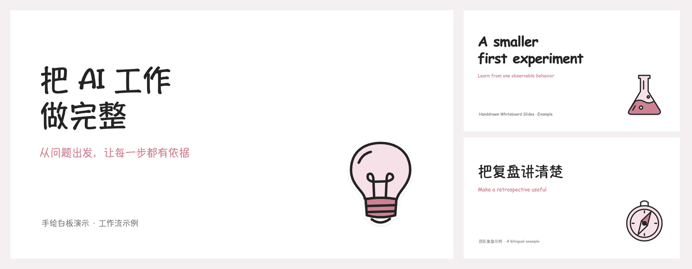
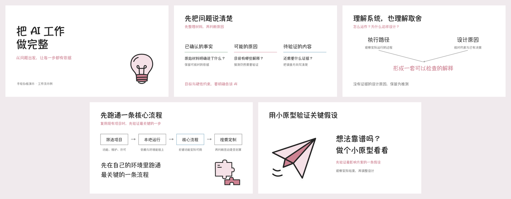
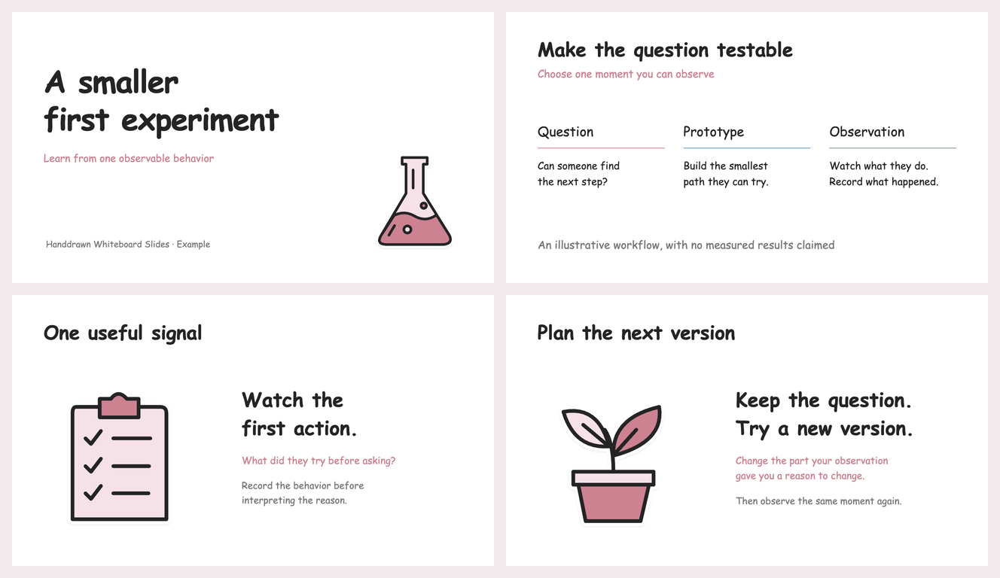
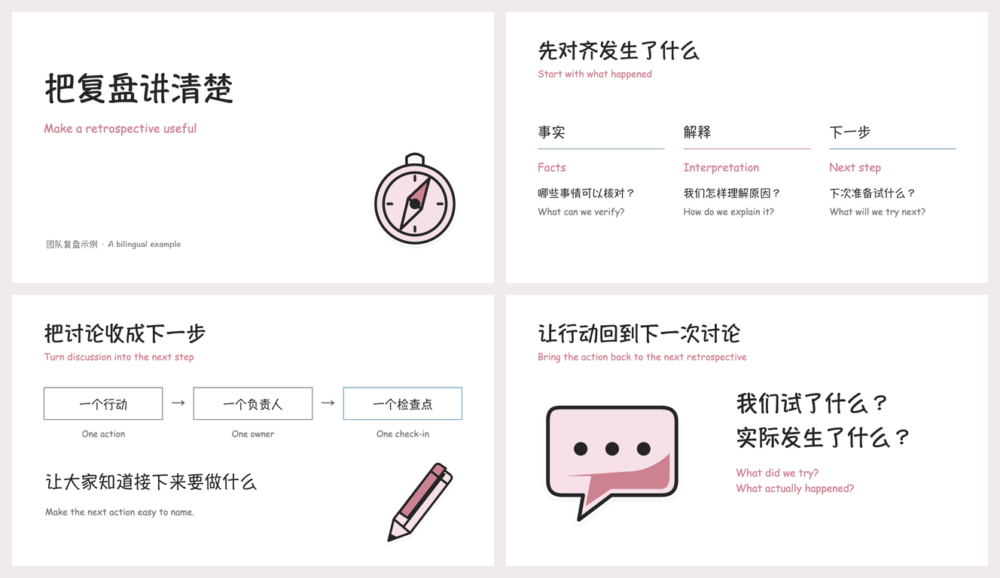
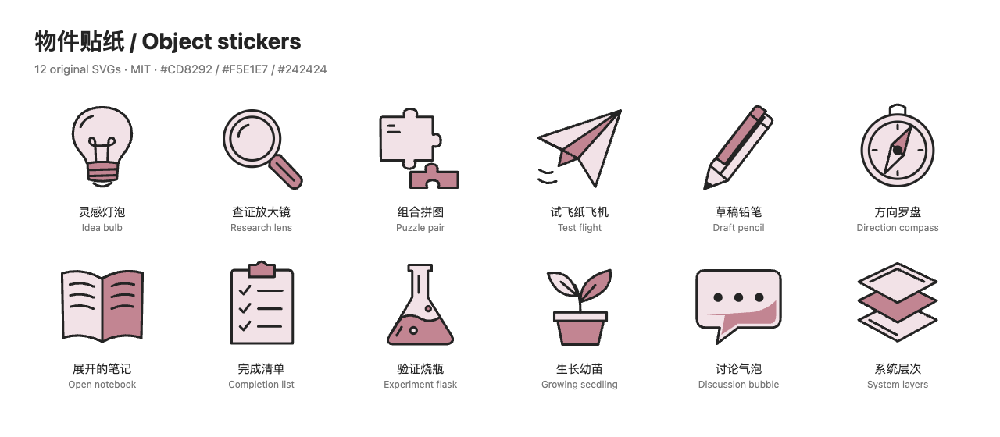

# 手绘白板演示

[中文](README.md) · [English](README.en.md)

**把一份材料，讲成几页清楚、轻松的幻灯片。**

一个面向 Codex 的演示制作 Skill：白底、中文手写字、粉色强调、可编辑图解，以及开箱可用的物件贴纸。适合技术分享、教程、方案讲解、产品实验和团队复盘。



[](LICENSE) [](https://github.com/Yaosc972/handdrawn-whiteboard-slides/actions/workflows/check.yml)

## 你会得到什么

- **一套可复用的制作方法**：先取舍内容，再按关系选择版式，一页围绕一个问题或结论。
- **12 张原创 SVG 贴纸**：透明背景、白色模切边、统一粉色，可直接插入或批量改色，随仓库采用 MIT 许可。
- **3 组可运行的演示**：共 13 页，覆盖中文、英文和中英双语。每组附 PDF，HTML 版本可以离线翻页、全屏播放和重新打印。
- **局部修改工作流**：更换插画时保留文字、图解、背景和页数。

这是一个 Skill、素材包和示例集合。Skill 本身不绑定幻灯片生成引擎：使用时沿用你的 PowerPoint、HTML 或在线演示工具。仓库里的示例是 HTML，不包含预生成的 PPTX。

## 安装

```bash
git clone https://github.com/Yaosc972/handdrawn-whiteboard-slides.git \
  ~/.codex/skills/handdrawn-whiteboard-slides
```

如果设置了 `CODEX_HOME`，安装到对应目录的 `skills/handdrawn-whiteboard-slides`。安装后打开一个新的 Codex 会话。更新已有安装：

```bash
git -C ~/.codex/skills/handdrawn-whiteboard-slides pull --ff-only
```

阅读和使用 Skill 不要求 Node.js。运行贴纸导出脚本或仓库检查时需要 **Node.js 22+**，无需 `npm install`，也不需要 API Key。

## 这样开始

从文章、笔记或需求材料制作演示：

```text
使用 $handdrawn-whiteboard-slides，把下面的材料做成 5 页演示。
面向第一次接触这个主题的同事。
保留白底、手写字和粉色强调，用物件贴纸，不用人物。
每页只讲一个重点，图解和正文保持可编辑。
```

给现有文稿换插画：

```text
使用 $handdrawn-whiteboard-slides，把这套演示的人物换成物件贴纸。
保留现有文字、图解、背景与页数，只适配插图的位置和大小。
```

生成英文内容：

```text
Use $handdrawn-whiteboard-slides to make a four-slide English presentation
from these notes. Keep a white background, handwritten type, pink accents,
and object stickers. Use one main idea per slide.
```

可以继续指定受众、页数、语言、字体、强调色和最终文件格式。用户明确指定的要求优先于默认风格。

## 看几个例子

直接在浏览器打开 [示例入口](examples/index.html)。GitHub 网页展示 HTML 源码；翻页演示需要克隆或下载仓库后在本地打开。

| 示例 | 语言 / 页数 | 主要构图 | 源码 |
|---|---|---|---|
| 把 AI 工作做完整 | 中文 · 5 页 | 大字开场、信息分类、关系汇合、流程、提问 | [HTML](examples/ai-workflow/index.html) · [PDF](examples/ai-workflow/slides.pdf) |
| A smaller first experiment | English · 4 slides | 实验开场、三步拆解、观察、迭代 | [HTML](examples/product-experiment/index.html) · [PDF](examples/product-experiment/slides.pdf) |
| 把复盘讲清楚 | 中英双语 · 4 页 | 主题开场、概念区分、行动流程、回顾 | [HTML](examples/team-retrospective/index.html) · [PDF](examples/team-retrospective/slides.pdf) |

如果当前环境不方便打开本地文件，也可以在仓库根目录运行：

```bash
python3 -m http.server 8000
# 浏览器打开 http://localhost:8000/examples/
```

左右方向键、空格或页面按钮均可翻页。使用“打印 / PDF”导出完整演示，所有页面都会进入打印布局。正文和图解可直接在 HTML 源码中编辑。

<details>
<summary>展开查看每组示例的全部页面</summary>

**中文 AI 工作流**



**English product experiment**



**中英双语团队复盘**



</details>

## 贴纸资源



完整资源位于 [assets/stickers](assets/stickers)，也可以打开[离线贴纸目录](assets/stickers/index.html)。每个物件都有独立 SVG，名称与中英文说明收录在 [manifest.json](assets/stickers/manifest.json)。

| 用途 | 可选物件 |
|---|---|
| 想法、观察与验证 | 灯泡、放大镜、烧瓶、清单 |
| 组合、理解与架构 | 拼图、展开的笔记、系统层次 |
| 设计、取舍与尝试 | 铅笔、罗盘、纸飞机 |
| 反馈与持续改进 | 讨论气泡、幼苗 |

直接使用 SVG，或通过脚本导出：

```bash
node scripts/render-stickers.mjs --list
node scripts/render-stickers.mjs --icons lightbulb,magnifier,puzzle,paper-plane --output work/stickers
node scripts/render-stickers.mjs --icons all --output work/all-stickers
```

也可以调整整套主题色，白色模切边与几何形状保持不变：

```bash
node scripts/render-stickers.mjs --icons all \
  --accent '#649AB6' --pale '#E8F1F7' --ink '#242424' \
  --output work/blue-stickers
```

## 风格与排版

| 元素 | 默认值 |
|---|---|
| 幻灯片比例 | 16:9，参考画布 1280 × 720 |
| 背景 / 文字 | `#FFFFFF` / `#242424` |
| 粉色 / 浅粉色 | `#CD8292` / `#F5E1E7` |
| 中文字体 | Hannotate SC、HanziPen SC 或 LXGW WenKai |
| 英文短标签 | Comic Sans MS 或设备可用的手写体 |
| 插图 | 通常一页一个相关物件，也可以不放 |

字体文件不随仓库分发，示例使用设备现有字体，跨设备显示可能略有不同。需要固定字体效果时，请在你的演示环境中安装有合适许可的字体。更多参数见[版式指南](references/layouts.md)。

## 仓库结构

```text
SKILL.md                   Skill 入口
agents/openai.yaml         Codex 中的名称与默认提示
assets/stickers/           12 张原创 SVG 与中英目录
assets/previews/           README 预览图
examples/                  三组可离线打开的演示
references/                版式和贴纸使用说明
scripts/                   贴纸导出与仓库检查
tests/                     导出、改色和异常输入测试
```

## 开发与贡献

```bash
npm test
npm run check
```

测试不需要额外安装依赖。欢迎改进版式、增加物件、补充翻译，或提交能复现的问题。贡献要求和检查方式见 [CONTRIBUTING.md](CONTRIBUTING.md)。

## 许可

代码、Skill 文本、原创贴纸和示例均采用 [MIT License](LICENSE)，可以使用、修改和再分发，并保留许可声明。字体说明与素材来源见 [NOTICE.md](NOTICE.md)。
